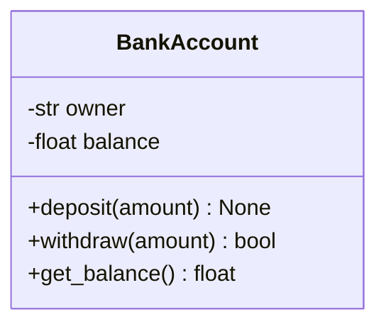
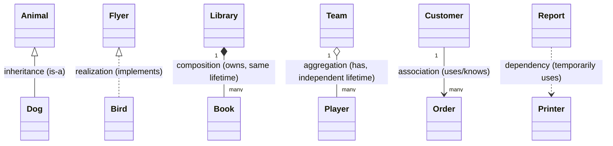
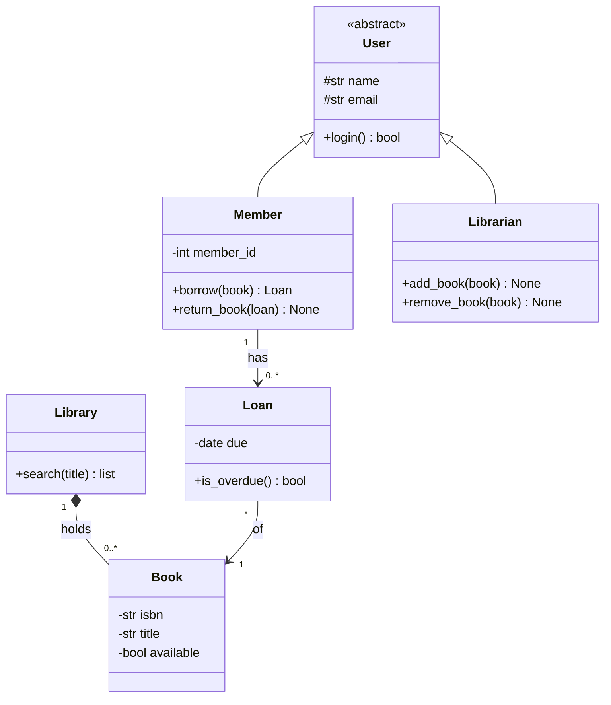
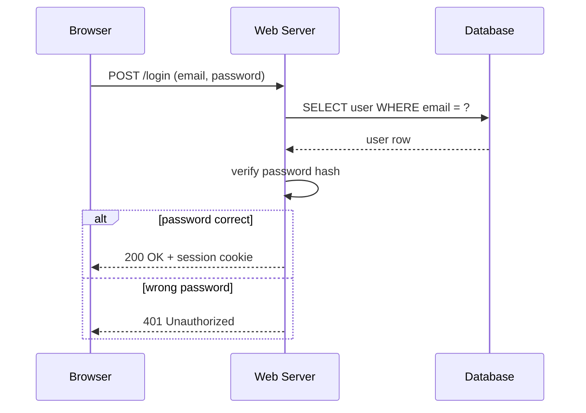
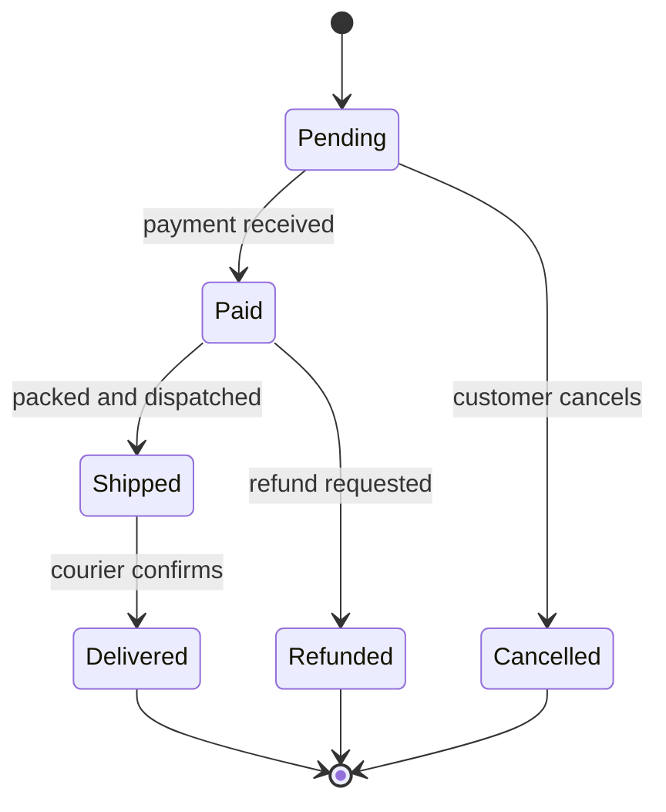
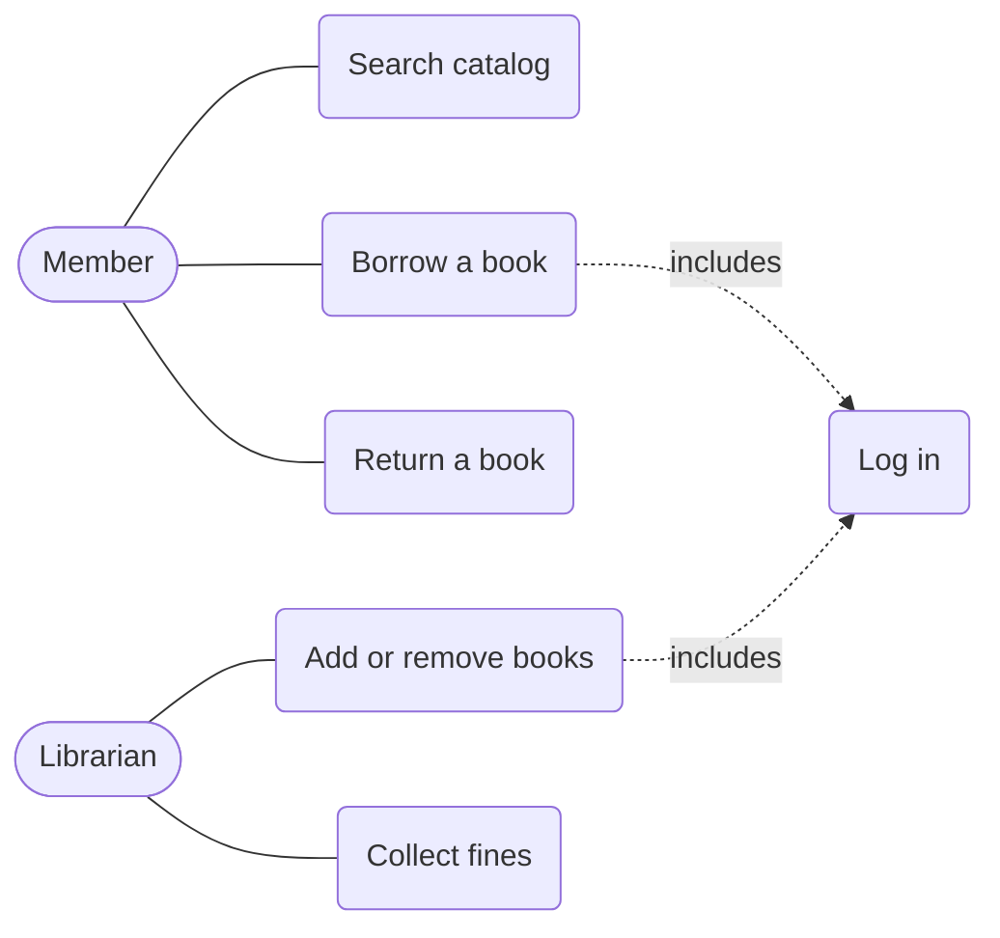

# UML and Class Diagrams

**Prerequisites:** [OOP from scratch](00-oop-from-scratch.md), [inheritance](inheritance-mro/README.md), [composition and design](composition-design/README.md). **You will learn:** what **UML** (Unified Modeling Language) is and when drawing is worth the effort; how to read and write **class diagrams** (attributes, methods, visibility, and the six relationships: **inheritance, realization, association, aggregation, composition, dependency**, plus **multiplicity**); how each relationship looks in **Python code**; the three other diagrams that matter in practice (**sequence, state, use case**); and a small Python tool that **generates a class diagram from real classes**. Diagrams are written in **Mermaid** (plain text that GitHub, VS Code, and many documentation tools render), so they live in version control next to the code.

## 1. In plain words

A diagram is a picture of how a program is organized, drawn so a person can grasp it in seconds instead of reading thousands of lines. **UML** is the standard vocabulary for such pictures (boxes for classes, arrows for relationships) so that two engineers draw and read them the same way.

You do **not** need to draw UML for everything. It earns its keep in four situations:

1. **Designing before coding**: sketch the classes and relationships on a whiteboard to see if the design makes sense.
2. **Explaining** a system to a teammate, a new hire, or an interviewer ("design a parking lot": the class diagram is the answer).
3. **Documenting** a stable architecture (a few key diagrams beat pages of prose).
4. **Reverse-engineering** unfamiliar code (generate a diagram and see the structure).

Keep diagrams **small and purposeful**: one idea per diagram, not "every class in the project". An out-of-date giant diagram is worse than none.

## 2. Class diagrams: the basic box

A class is a box with three compartments: **name**, **attributes** (data) and **operations** (methods).



**Visibility markers** before each member:

| Mark | Meaning | Python equivalent |
|------|---------|-------------------|
| `+` | public | `name` |
| `-` | private | `__name` (name-mangled) or by strong convention |
| `#` | protected | `_name` (single underscore convention) |
| `~` | package/internal | module-private by convention |

Other notation: *italic* class name or `<<abstract>>` for an abstract class; `<<interface>>` for a protocol/ABC with only abstract methods; `$` (or underline) for static members. The same class in Python:

```python
class BankAccount:
    def __init__(self, owner: str, balance: float = 0.0):
        self.__owner = owner                    # "-": private
        self.__balance = balance

    def deposit(self, amount: float) -> None:    # "+": public
        self.__balance += amount

    def withdraw(self, amount: float) -> bool:
        if amount > self.__balance:
            return False
        self.__balance -= amount
        return True

    def get_balance(self) -> float:
        return self.__balance
```

## 3. The relationships (the part that matters)

Arrows between classes say **how they are connected**. There are six you need, from strongest to weakest coupling.



| Relationship | Arrow | Read it as | Lifetime | Typical code |
|--------------|-------|------------|----------|--------------|
| **Inheritance** (generalization) | `Child --|> Parent` (Mermaid: `Parent <|-- Child`) | "Child **is a** Parent" | n/a | `class Dog(Animal)` |
| **Realization** | `Impl ..|> Interface` (Mermaid: `Interface <|.. Impl`) | "Impl **implements** Interface" | n/a | `class Bird(Flyer)` with an ABC or Protocol |
| **Composition** | `Whole *-- Part` | "Whole **owns** Part; Part dies with Whole" | tied together | the part is created inside the whole and not shared |
| **Aggregation** | `Whole o-- Part` | "Whole **has** Part; Part can exist alone" | independent | the part is passed in and may be shared |
| **Association** | `A --> B` | "A **knows/uses** B over time" | independent | `self.b = b` kept as an attribute |
| **Dependency** | `A ..> B` | "A **depends on** B only temporarily" | only during a call | `B` appears as a parameter, local variable or return value |

**Multiplicity** labels how many objects take part at each end: `1`, `0..1` (optional), `*` or `many`, `1..*` (one or more), `2..5`.

### Each relationship in Python

```python
from abc import ABC, abstractmethod

# Inheritance: Dog IS-A Animal
class Animal:
    def __init__(self, name):
        self.name = name

class Dog(Animal):
    def speak(self):
        return f"{self.name} says Woof"

# Realization: Duck implements the Flyer interface
class Flyer(ABC):
    @abstractmethod
    def fly(self) -> str: ...

class Duck(Flyer):
    def fly(self) -> str:
        return "flap flap"

# Composition: the House creates and owns its Rooms; Rooms do not exist without it
class Room:
    def __init__(self, name):
        self.name = name

class House:
    def __init__(self):
        self.rooms = [Room("kitchen"), Room("bedroom")]       # created inside: same lifetime

# Aggregation: a Team has Players, but Players exist independently and can move teams
class Player:
    def __init__(self, name):
        self.name = name

class Team:
    def __init__(self, players):
        self.players = players                                 # passed in from outside: shared, independent lifetime

# Association: an Order keeps a reference to its Customer
class Customer:
    def __init__(self, name):
        self.name = name

class Order:
    def __init__(self, customer):
        self.customer = customer                               # stored as an attribute: a lasting link

# Dependency: Report only uses a Printer while it prints
class Printer:
    def print_text(self, text):
        return f"printing: {text}"

class Report:
    def print_with(self, printer: Printer):                    # Printer appears only as a parameter
        return printer.print_text("quarterly numbers")

ana, ben = Player("Ana"), Player("Ben")
team = Team([ana, ben])
other_team = Team([ben])                                      # Ben belongs to two teams: aggregation, not composition
print(Dog("Rex").speak(), Duck().fly(), [r.name for r in House().rooms])
# Rex says Woof flap flap ['kitchen', 'bedroom']
print(Report().print_with(Printer()), Order(Customer("Cy")).customer.name)
# printing: quarterly numbers Cy
print(team.players[1] is other_team.players[0])               # True
```

### How to choose between them (the rule of thumb)

```text
Is it a kind of the other?                                  -> inheritance (but prefer composition if unsure)
Does it just promise to provide certain methods?           -> realization (interface)
Does the part die when the whole is deleted?               -> composition (filled diamond)
Is the part shared / does it outlive the whole?            -> aggregation (hollow diamond)
Does it keep a reference over time?                        -> association (plain arrow)
Does it only use it inside one method call?                -> dependency (dashed arrow)
```

Many teams skip the subtle **aggregation vs composition** distinction and just draw an association with a clear label. What matters is that the diagram agrees with the code and conveys intent. Prefer **composition over inheritance** ([composition lesson](composition-design/README.md)): the diagram makes inheritance trees visible, and deep ones are a design smell.

## 4. A complete example: a library system

Requirements: a library has many books; members borrow books; a loan links a member to a book with a due date; staff and members are kinds of users.



Read it aloud: *"A member and a librarian are kinds of user. A library holds zero or more books (composition: books belong to one library). A member has any number of loans, and each loan refers to exactly one book."* If you can narrate the diagram in plain sentences, it is a good one.

And the code that matches it (kept small):

```python
from datetime import date, timedelta

class User:
    def __init__(self, name, email):
        self._name, self._email = name, email                  # "#": protected

class Book:
    def __init__(self, isbn, title):
        self.__isbn, self.__title, self.available = isbn, title, True

    @property
    def title(self):
        return self.__title

class Loan:
    def __init__(self, book, days=14):
        self.book = book                                        # association: a Loan refers to one Book
        self.__due = date(2026, 11, 7) + timedelta(days=days)
        book.available = False

    def is_overdue(self, today):
        return today > self.__due

class Member(User):
    def __init__(self, name, email, member_id):
        super().__init__(name, email)
        self.__member_id = member_id
        self.loans = []                                         # association: a Member has 0..* Loans

    def borrow(self, book):
        if not book.available:
            raise ValueError(f"{book.title} is not available")
        loan = Loan(book)
        self.loans.append(loan)
        return loan

class Library:
    def __init__(self):
        self._books = []                                        # composition: books belong to this library

    def add_book(self, book):
        self._books.append(book)

    def search(self, title):
        return [b for b in self._books if title.lower() in b.title.lower()]

library = Library()
library.add_book(Book("978-0", "Dune"))
library.add_book(Book("978-1", "Dune Messiah"))
member = Member("Ana", "ana@mail.com", 7)
loan = member.borrow(library.search("dune")[0])
print([b.title for b in library.search("dune")], loan.book.available)       # ['Dune', 'Dune Messiah'] False
print(loan.is_overdue(date(2026, 11, 30)), loan.is_overdue(date(2026, 11, 10)))      # True False
```

## 5. Generating a class diagram from real code

Reading a diagram is useful; **producing** one automatically from code keeps documentation honest. Python's `inspect` and `typing` can list classes, their bases, public methods and annotated attributes. This small tool emits Mermaid text:

```python
import inspect

def mermaid_class_diagram(*classes):
    """Return Mermaid classDiagram text for the given classes (members and inheritance)."""
    lines = ["classDiagram"]
    names = {cls.__name__ for cls in classes}
    for cls in classes:
        lines.append(f"    class {cls.__name__} {{")
        for attr, annotation in getattr(cls, "__annotations__", {}).items():
            type_name = getattr(annotation, "__name__", str(annotation))
            marker = "-" if attr.startswith("__") else "#" if attr.startswith("_") else "+"
            lines.append(f"        {marker}{type_name} {attr.lstrip('_')}")
        for name, member in cls.__dict__.items():
            if inspect.isfunction(member) and not (name.startswith("__") and name.endswith("__")):
                params = ", ".join(p for p in inspect.signature(member).parameters if p != "self")
                marker = "-" if name.startswith("__") else "#" if name.startswith("_") else "+"
                lines.append(f"        {marker}{name.lstrip('_')}({params})")
        lines.append("    }")
    for cls in classes:
        for base in cls.__bases__:
            if base.__name__ in names:
                lines.append(f"    {base.__name__} <|-- {cls.__name__}")      # inheritance arrows between the given classes
    return "\n".join(lines)

class Shape:
    name: str
    def area(self):
        raise NotImplementedError
    def describe(self):
        return f"{self.name}: {self.area()}"

class Circle(Shape):
    radius: float
    def area(self):
        return 3.14159 * self.radius ** 2
    def _scale(self, factor):
        self.radius *= factor

diagram = mermaid_class_diagram(Shape, Circle)
print(diagram)
# classDiagram
#     class Shape {
#         +str name
#         +area()
#         +describe()
#     }
#     class Circle {
#         +float radius
#         +area()
#         #scale(factor)
#     }
#     Shape <|-- Circle
```

Paste the output into any Mermaid renderer (GitHub markdown, <https://mermaid.live>) to see the picture. Dedicated tools do this for whole projects: **`pyreverse`** (shipped with pylint: `pyreverse -o png mypackage`) draws class and package diagrams from a Python package, and IDEs (PyCharm/WebStorm, VS Code extensions) can display them too.

## 6. Sequence diagrams: behavior over time

A class diagram is **static structure**. A **sequence diagram** shows **messages between objects in order**, top to bottom: ideal for one scenario such as "user logs in" or "place an order". Participants are columns; arrows are calls; dashed arrows are returns.



Use them to find **who talks to whom**, spot chatty designs (too many round trips), and communicate API flows. In code they correspond to the call chain; the [HTTP lab](../07-networking/dns-http/01-http-from-scratch.md) and [TLS handshake](../07-networking/tls-security/01-cryptography-and-tls-lab.md) are naturally drawn as sequence diagrams.

## 7. State diagrams: the life of one object

Objects that behave differently depending on their **state** (an order, a connection, a traffic light) are clearest as a **state machine**: states in rounded boxes, transitions as arrows labeled with the event that triggers them. (This is the [State pattern](design-patterns/behavioral/state.md) drawn.)



The diagram doubles as a test checklist: every arrow is a case, and every *missing* arrow is a bug waiting to happen (can a `Shipped` order be cancelled? the diagram says no, so the code must reject it). In Python it becomes a transition table:

```python
TRANSITIONS = {
    "Pending":   {"payment received": "Paid", "customer cancels": "Cancelled"},
    "Paid":      {"packed and dispatched": "Shipped", "refund requested": "Refunded"},
    "Shipped":   {"courier confirms": "Delivered"},
    "Delivered": {}, "Cancelled": {}, "Refunded": {},
}

def advance(state, event):
    try:
        return TRANSITIONS[state][event]
    except KeyError:
        raise ValueError(f"cannot '{event}' while {state}") from None

state = "Pending"
for event in ("payment received", "packed and dispatched", "courier confirms"):
    state = advance(state, event)
print(state)                                                   # Delivered
try:
    advance("Shipped", "customer cancels")
except ValueError as e:
    print(e)                                                   # cannot 'customer cancels' while Shipped
```

## 8. Use case diagrams: what the system is for

A **use case diagram** shows **actors** (people or external systems) and the **goals** they achieve with the system, with no internal design. It is for agreeing on scope with non-programmers.



(Mermaid has no dedicated use-case syntax; a `flowchart` with the same shapes works. UML also has **activity diagrams** (flowcharts of a process, with decisions and parallel branches), **component diagrams** (services and their interfaces) and **deployment diagrams** (which software runs on which machine); the [system design basics](../09-interview-playbook/system-design-basics/README.md) boxes-and-arrows pictures are informal component diagrams.)

## 9. Choosing the diagram

| You want to show... | Use |
|---------------------|-----|
| The static structure: classes, fields, relationships | **class diagram** |
| One scenario step by step between objects or services | **sequence diagram** |
| Lifecycle of a single object with a few states | **state diagram** |
| Who uses the system and for what | **use case diagram** |
| A business process or algorithm flow | **activity diagram / flowchart** |
| Services, databases and how they connect | **component / architecture diagram** |
| Data tables and their keys | **ER (entity-relationship) diagram** ([normalization lab](../05-databases/normalization-schema-design/01-normalization-lab.md)) |

## 10. Drawing diagrams well

1. **One purpose per diagram.** Title it with the question it answers ("Order checkout: classes involved").
2. **Show only what matters.** Omit getters, setters and obvious attributes; include the relationships and key methods.
3. **Name relationships** and give **multiplicities** on important links.
4. **Keep arrows flowing one way** (parents above children, whole above part) and avoid crossing lines.
5. **Diagram as code** (Mermaid, PlantUML) lives in the repository, shows up in diffs and is updated with the code; screenshots rot.
6. **Draw before you code, simplify after.** A whiteboard sketch of five classes is a fine design tool; if it needs a poster, the design is too complicated.
7. **Check against the code.** Generate from code where possible (section 5) and treat a mismatch as a bug in the diagram or the code.

## 11. Two real-world examples

**Example 1: A design-review meeting.** Before building a notification system, the team draws a class diagram: `Notification` with subclasses `Email`, `SMS`, `Push`, a `Sender` interface they all realize, and a `NotificationService` associated with a list of senders. In ten minutes someone notices that `Push` needs a device token the others do not, so the common interface is revised. The mistake was cheaper to fix on a whiteboard than after writing the code.

**Example 2: Onboarding onto a legacy codebase.** A new hire runs `pyreverse` on the project and gets a class diagram per package. The central `Order` class and its relationships jump out, and a single sequence diagram of the checkout flow, drawn while stepping through the code in a debugger, explains in one page what a week of reading would.

## 12. Common mistakes

- Diagrams that show every class and attribute (unreadable, instantly stale).
- Using inheritance arrows for "has-a" relationships (and vice versa).
- Confusing composition and aggregation, or drawing them backwards (the diamond sits on the **whole**).
- Arrow direction on dependencies and associations that disagrees with the code.
- No multiplicities on the relationships that matter.
- Treating UML as a goal instead of a communication tool; spending hours on diagram aesthetics.
- Screenshots of diagrams pasted into docs with no source to update.

## 13. Practice

1. Draw (in Mermaid) a class diagram for a **parking lot**: a lot has many levels, a level has many spots (compact, large, motorcycle), vehicles (car, truck, motorcycle) park in spots, and a ticket links a vehicle to a spot with an entry time.
2. Say which relationship: (a) `Car` and `Engine` where the engine is created by the car, (b) `Student` and `Course` (students enroll, courses persist without them), (c) `Order` and `PaymentGateway` used only inside `checkout()`, (d) `Cat` and `Animal`.
3. Write the Python skeleton for your parking-lot diagram.
4. Use `mermaid_class_diagram` on the `BankAccount` class from section 2. What visibility markers appear, and why?
5. Draw a sequence diagram for "user adds an item to the cart" with a browser, web server, cart service and database.
6. Draw a state diagram for a **traffic light** with `Red`, `Green`, `Yellow`, and write its transition table in Python.
7. When would you *not* draw a class diagram?

<details>
<summary>Solutions</summary>

1. ```mermaid
   classDiagram
       class ParkingLot {
           +find_spot(vehicle) Spot
       }
       class Level {
           -int number
       }
       class Spot {
           -str size
           -bool occupied
       }
       class Vehicle {
           <<abstract>>
           #str plate
       }
       class Ticket {
           -datetime entered
       }
       Vehicle <|-- Car
       Vehicle <|-- Truck
       Vehicle <|-- Motorcycle
       ParkingLot "1" *-- "1..*" Level
       Level "1" *-- "many" Spot
       Ticket "1" --> "1" Vehicle
       Ticket "1" --> "1" Spot
   ```
2. (a) composition, (b) aggregation (or association), (c) dependency, (d) inheritance.
3. ```python
   class Vehicle:
       def __init__(self, plate): self._plate = plate
   class Car(Vehicle): pass
   class Truck(Vehicle): pass
   class Motorcycle(Vehicle): pass
   class Spot:
       def __init__(self, size): self.size, self.occupied = size, False
   class Level:
       def __init__(self, number, spots): self.number, self.spots = number, spots
   class ParkingLot:
       def __init__(self, levels): self.levels = levels
       def find_spot(self, vehicle):
           return next((s for lvl in self.levels for s in lvl.spots if not s.occupied), None)
   class Ticket:
       def __init__(self, vehicle, spot, entered): self.vehicle, self.spot, self.entered = vehicle, spot, entered
   lot = ParkingLot([Level(1, [Spot("compact"), Spot("large")])])
   print(lot.find_spot(Car("ABC-123")).size)                         # compact
   ```
4. ```python
   class BankAccount:
       def __init__(self, owner, balance=0): self.owner, self.balance = owner, balance
       def deposit(self, amount): self.balance += amount
       def _audit(self): pass
   print(mermaid_class_diagram(BankAccount))
   # classDiagram
   #     class BankAccount {
   #         +deposit(amount)
   #         #audit()
   #     }
   ```
   `deposit` is public (`+`) and `_audit` (single underscore) is protected (`#`). The tool lists only annotated attributes, so `owner` and `balance` (assigned in `__init__` without annotations) do not appear: add class-level annotations to show them.
5. ```mermaid
   sequenceDiagram
       participant B as Browser
       participant W as Web Server
       participant C as Cart Service
       participant D as Database
       B->>W: POST /cart/items (product 42)
       W->>C: add_item(user, 42)
       C->>D: INSERT cart_item
       D-->>C: ok
       C-->>W: updated cart
       W-->>B: 201 Created + cart JSON
   ```
6. ```mermaid
   stateDiagram-v2
       [*] --> Red
       Red --> Green : timer
       Green --> Yellow : timer
       Yellow --> Red : timer
   ```
   ```python
   LIGHT = {"Red": "Green", "Green": "Yellow", "Yellow": "Red"}
   state = "Red"
   cycle = []
   for _ in range(4):
       state = LIGHT[state]; cycle.append(state)
   print(cycle)                                                   # ['Green', 'Yellow', 'Red', 'Green']
   ```
7. When the code is a few small functions with no meaningful relationships, when a sentence or a short list explains it, when the diagram would be too large to help, or when nobody will keep it up to date; in those cases prefer clear code, docstrings and a README.

</details>

## 14. Check yourself

1. What does UML give you that plain code does not?
2. What are the six relationships and the arrow style of each?
3. What is the difference between composition and aggregation?
4. What do `+`, `-` and `#` mean?
5. When do you draw a sequence diagram rather than a class diagram?
6. Why keep diagrams as code?

<details>
<summary>Answers</summary>

1. A fast, shared visual overview of structure and behavior that is easier to discuss and review than thousands of lines of code.
2. Inheritance (solid line, hollow triangle), realization (dashed line, hollow triangle), composition (solid line, filled diamond on the whole), aggregation (solid line, hollow diamond on the whole), association (solid line with open arrow), dependency (dashed line with open arrow).
3. Composition: the part belongs to exactly one whole and dies with it. Aggregation: the whole has the part but the part can exist independently and be shared.
4. Public, private and protected members.
5. To show the order of interactions for one scenario over time (who calls whom); class diagrams show static structure.
6. Text diagrams live in version control, show up in diffs, are updated with the code and render in documentation tools; screenshots go stale.

</details>

[Back to OOP overview](README.md)
