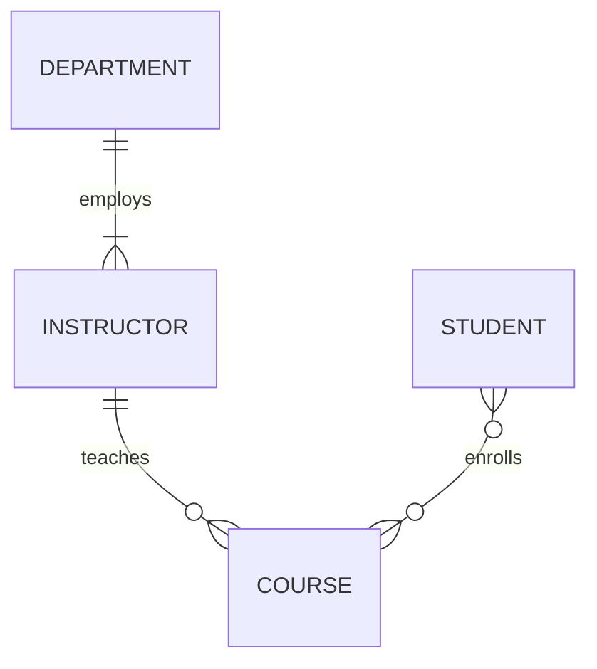
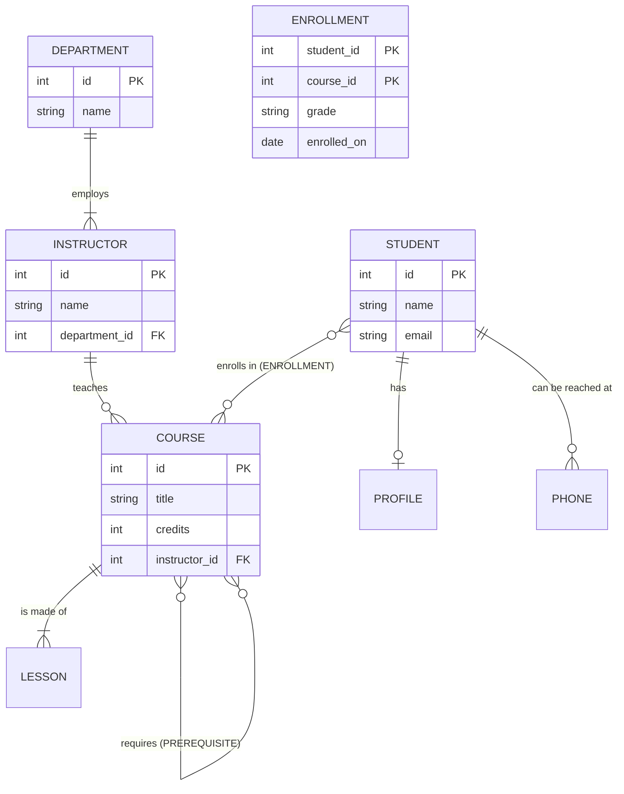

# What Is a Database? And How to Model One (ER Diagrams)

**Prerequisites:** none beyond basic Python; the [SQL first steps](relational-sql/01-sql-first-steps.md) lesson is a good companion. **You will learn:** what a **database** and a **DBMS** are and why we use them instead of files; the main kinds of databases; the **modeling process** (requirements, conceptual **ER diagram**, logical tables, physical details); the ER vocabulary (**entities, attributes, keys, relationships, cardinality, participation**); the **rules for turning an ER diagram into tables** (one-to-many, one-to-one, many-to-many, multi-valued attributes, weak entities, self-references, inheritance); and how to **enforce the model with constraints** and **test** it. Everything runs in SQLite from Python, and the diagrams are **Mermaid** text.

## 1. In plain words

A **database** is an organized collection of data that programs can store, find, change and protect reliably. The software that manages it is the **DBMS** (database management system): PostgreSQL, MySQL, SQLite, Oracle, SQL Server, MongoDB, Redis...

Why not just save data in files (CSV or JSON)? Files work for small, single-user data. A DBMS adds what files lack:

| Need | A plain file | A DBMS |
|------|--------------|--------|
| Find one record among millions quickly | scan the whole file | **indexes** (milliseconds) |
| Many users changing data at once safely | corrupted or lost updates | **transactions and locking** ([ACID](transactions-acid/01-transactions-lab.md)) |
| Survive a crash mid-write | half-written file | **logging and recovery** |
| Keep data valid (no negative price, no order without a customer) | up to every program | **constraints enforced centrally** |
| Ask flexible questions | write new code each time | **a query language** (SQL) |
| Control who sees what | file permissions only | **users, roles, row/column permissions** |

```python
import sqlite3, json, os, tempfile

# A file approach: every "query" is code you write and every update rewrites everything.
people = [{"id": i, "name": f"user{i}", "country": "PK" if i % 3 == 0 else "US"} for i in range(1, 10_001)]
path = os.path.join(tempfile.mkdtemp(), "people.json")
json.dump(people, open(path, "w"))
loaded = json.load(open(path))
print(len([p for p in loaded if p["country"] == "PK"]))                      # 3333   (found by scanning everything)

# The database approach: declare what you want; the engine decides how.
db = sqlite3.connect(":memory:")
db.execute("CREATE TABLE people (id INTEGER PRIMARY KEY, name TEXT NOT NULL, country TEXT NOT NULL)")
db.executemany("INSERT INTO people VALUES (:id, :name, :country)", people)
print(db.execute("SELECT COUNT(*) FROM people WHERE country = 'PK'").fetchone()[0])      # 3333
```

### Kinds of databases

| Kind | Stores | Typical use |
|------|--------|-------------|
| **Relational** (SQL) | tables of rows and columns linked by keys | business data, almost every application |
| **Document** | JSON documents | flexible nested records |
| **Key-value** | `key -> value` | caches, sessions |
| **Wide-column** | partitioned sparse rows | huge write volumes |
| **Graph** | nodes and edges | relationship-heavy queries |
| **Search / time-series / vector** | specialized indexes | text search, metrics, embeddings |

(Details and trade-offs: [NoSQL lab](nosql/01-nosql-lab.md).) **Start with a relational database**; this lesson is about designing one well.

### Ways a DBMS runs

| Style | Example | Notes |
|-------|---------|-------|
| **Embedded** (a library in your program, one file) | SQLite | phones, browsers, small apps, tests |
| **Client-server** (a separate server process many clients connect to) | PostgreSQL, MySQL | web applications |
| **Managed cloud service** | Amazon RDS, Cloud SQL, Supabase | the same engines, operated for you |

### OLTP versus OLAP

| | **OLTP** (transactions) | **OLAP** (analytics) |
|---|-------------------------|----------------------|
| Workload | many small reads and writes ("place an order") | few huge scans and aggregates ("sales by region by year") |
| Schema | normalized (no duplication) | denormalized **star schema** or columnar storage |
| Engines | PostgreSQL, MySQL | BigQuery, Snowflake, ClickHouse, DuckDB |

This lesson focuses on OLTP modeling; the [normalization lab](normalization-schema-design/01-normalization-lab.md) covers the rules of a clean schema.

## 2. The modeling process

Good schemas start on paper, not in `CREATE TABLE`.

```text
1. REQUIREMENTS   what must the system remember? what questions will it answer? (talk to users, list nouns and rules)
2. CONCEPTUAL     an ER diagram: entities, attributes, relationships, cardinalities (no technology yet)
3. LOGICAL        translate to tables, keys and foreign keys; normalize
4. PHYSICAL       choose column types, indexes, constraints, partitioning for a specific DBMS
5. REVIEW + TEST  walk real scenarios through the model; insert bad data and check it is rejected
```

**Tip:** underline the **nouns** in the requirements (candidate entities and attributes) and the **verbs** (candidate relationships): "A **student enrolls** in **courses**; each **course** is taught by one **instructor**."

## 3. ER vocabulary

| Term | Meaning | Example |
|------|---------|---------|
| **Entity** | a thing we keep data about (becomes a table) | `Student`, `Course`, `Instructor` |
| **Attribute** | a property of an entity (becomes a column) | `Student.name`, `Course.credits` |
| **Key attribute** | uniquely identifies an entity instance | `student_id` |
| **Relationship** | an association between entities | a Student **enrolls in** a Course |
| **Cardinality** | how many of one side relate to the other | 1:1, 1:N, M:N |
| **Participation** | must every entity take part? **total** (mandatory) or **partial** (optional) | every Course must have an Instructor |
| **Weak entity** | cannot be identified without its parent | `OrderLine` needs its `Order` |

Attribute kinds: **simple** (`age`), **composite** (`address` made of street, city, postcode: store the parts as separate columns), **multi-valued** (a person with several phone numbers: needs its own table), **derived** (`age` computed from `birth_date`: do not store, compute).

### Cardinality and participation in the notation

Mermaid `erDiagram` uses "crow's foot" symbols at each end of a line:

| Symbol | Meaning |
|--------|---------|
| `\|\|` | exactly one |
| `o\|` | zero or one |
| `}\|` | one or more |
| `}o` | zero or more |



Read `INSTRUCTOR ||--o{ COURSE : teaches` as: "**one** instructor teaches **zero or more** courses; each course has **exactly one** instructor." Read each end as "how many of *this* entity can be linked to one of the other".

## 4. A worked example: a course platform

**Requirements (in words).**

- A **department** has many instructors; every instructor belongs to exactly one department.
- An **instructor** teaches zero or more **courses**; every course has exactly one instructor.
- A **student** enrolls in many courses and a course has many students; each enrollment records a **grade** and a **date**.
- Each student has exactly one **profile** (a 1:1 extension holding bio and photo).
- A student can have several **phone numbers** (multi-valued).
- A course can have **prerequisite** courses (a course relates to other courses).
- Each course has ordered **lessons** that cannot exist without the course (weak entity).



## 5. From ER diagram to tables: the translation rules

| ER construct | Becomes | Details |
|--------------|---------|---------|
| **Entity** | a table | one column per attribute; pick a primary key |
| **1:N relationship** | a **foreign key on the "many" side** | `course.instructor_id REFERENCES instructor(id)`; `NOT NULL` if participation is total |
| **1:1 relationship** | a foreign key with **`UNIQUE`** (put it on the optional/dependent side), or merge the two tables | `profile.student_id UNIQUE REFERENCES student(id)` |
| **M:N relationship** | a **junction table** with two foreign keys; its primary key is the pair | `enrollment(student_id, course_id, ...)`; relationship attributes (grade) live here |
| **Multi-valued attribute** | its own table with a foreign key | `phone(student_id, number)` |
| **Weak entity** | a table whose primary key **includes the parent's key** | `lesson(course_id, position, ...)` with `PRIMARY KEY (course_id, position)` |
| **Self-referencing M:N** (course prerequisites) | a junction table with two foreign keys to the **same** table | `prerequisite(course_id, requires_id)` |
| **Composite attribute** | several columns | `street`, `city`, `postcode` |
| **Derived attribute** | nothing: compute in queries or views | `age` from `birth_date` |
| **Inheritance** (see section 8) | one table, or one per class | choose by queries and nulls |

```python
db = sqlite3.connect(":memory:")
db.execute("PRAGMA foreign_keys = ON")
db.executescript("""
CREATE TABLE department (
    id   INTEGER PRIMARY KEY,
    name TEXT NOT NULL UNIQUE
);
CREATE TABLE instructor (
    id            INTEGER PRIMARY KEY,
    name          TEXT NOT NULL,
    department_id INTEGER NOT NULL REFERENCES department(id)           -- total participation: every instructor has a department
);
CREATE TABLE course (
    id            INTEGER PRIMARY KEY,
    title         TEXT NOT NULL,
    credits       INTEGER NOT NULL CHECK (credits BETWEEN 1 AND 10),
    instructor_id INTEGER NOT NULL REFERENCES instructor(id)           -- 1:N, many side holds the key, mandatory
);
CREATE TABLE student (
    id    INTEGER PRIMARY KEY,
    name  TEXT NOT NULL,
    email TEXT NOT NULL UNIQUE
);
CREATE TABLE enrollment (                                              -- the M:N junction table
    student_id  INTEGER NOT NULL REFERENCES student(id),
    course_id   INTEGER NOT NULL REFERENCES course(id),
    grade       TEXT CHECK (grade IN ('A', 'B', 'C', 'D', 'F')),       -- NULL until graded
    enrolled_on TEXT NOT NULL,
    PRIMARY KEY (student_id, course_id)                                -- a student enrolls in a course at most once
);
CREATE TABLE profile (                                                 -- 1:1 with student
    student_id INTEGER PRIMARY KEY REFERENCES student(id),             -- primary key = foreign key forces at most one profile per student
    bio        TEXT
);
CREATE TABLE phone (                                                   -- multi-valued attribute
    student_id INTEGER NOT NULL REFERENCES student(id),
    number     TEXT NOT NULL,
    PRIMARY KEY (student_id, number)
);
CREATE TABLE lesson (                                                  -- weak entity: identified by (course, position)
    course_id INTEGER NOT NULL REFERENCES course(id) ON DELETE CASCADE,    -- delete a course and its lessons go too
    position  INTEGER NOT NULL,
    title     TEXT NOT NULL,
    PRIMARY KEY (course_id, position)
);
CREATE TABLE prerequisite (                                            -- self-referencing M:N
    course_id   INTEGER NOT NULL REFERENCES course(id),
    required_id INTEGER NOT NULL REFERENCES course(id),
    PRIMARY KEY (course_id, required_id),
    CHECK (course_id <> required_id)                                   -- a course cannot require itself
);
""")
print([r[0] for r in db.execute("SELECT name FROM sqlite_master WHERE type = 'table' ORDER BY name")])
# ['course', 'department', 'enrollment', 'instructor', 'lesson', 'phone', 'prerequisite', 'profile', 'student']
```

Nine tables from seven entities plus relationships: that is normal; M:N relationships and multi-valued attributes each add a table.

### Load sample data

```python
db.executescript("""
INSERT INTO department VALUES (1, 'Computer Science'), (2, 'Mathematics');
INSERT INTO instructor VALUES (1, 'Dr. Khan', 1), (2, 'Dr. Ali', 1), (3, 'Dr. Noor', 2);
INSERT INTO course VALUES (1, 'Intro to Programming', 3, 1), (2, 'Data Structures', 4, 1), (3, 'Algorithms', 4, 2), (4, 'Linear Algebra', 3, 3);
INSERT INTO student VALUES (1, 'Ana', 'ana@uni.edu'), (2, 'Bilal', 'bilal@uni.edu'), (3, 'Chen', 'chen@uni.edu');
INSERT INTO enrollment VALUES (1, 1, 'A', '2026-01-10'), (1, 2, 'B', '2026-01-10'), (2, 2, NULL, '2026-01-11'), (3, 1, 'C', '2026-01-12'), (3, 4, NULL, '2026-01-12');
INSERT INTO profile VALUES (1, 'Loves graphs');
INSERT INTO phone VALUES (1, '0300-1111111'), (1, '0300-2222222'), (2, '0321-3333333');
INSERT INTO lesson VALUES (2, 1, 'Arrays'), (2, 2, 'Linked lists'), (2, 3, 'Trees'), (3, 1, 'Sorting');
INSERT INTO prerequisite VALUES (2, 1), (3, 2);
""")

def q(sql, *p):
    return db.execute(sql, p).fetchall()

print(q("""SELECT s.name, c.title, e.grade FROM enrollment e JOIN student s ON s.id = e.student_id
           JOIN course c ON c.id = e.course_id ORDER BY s.name, c.title"""))
# [('Ana', 'Data Structures', 'B'), ('Ana', 'Intro to Programming', 'A'), ('Bilal', 'Data Structures', None), ('Chen', 'Intro to Programming', 'C'), ('Chen', 'Linear Algebra', None)]
print(q("""SELECT i.name, COUNT(c.id) FROM instructor i LEFT JOIN course c ON c.instructor_id = i.id GROUP BY i.id ORDER BY i.id"""))
# [('Dr. Khan', 2), ('Dr. Ali', 1), ('Dr. Noor', 1)]
print(q("""SELECT c.title, GROUP_CONCAT(r.title, ', ') FROM prerequisite p JOIN course c ON c.id = p.course_id
           JOIN course r ON r.id = p.required_id GROUP BY c.id ORDER BY c.id"""))
# [('Data Structures', 'Intro to Programming'), ('Algorithms', 'Data Structures')]
```

## 6. Make the database enforce the model

A model is only as good as its constraints. **Try to break each rule** and confirm the database refuses:

```python
def attempt(sql):
    try:
        db.execute(sql)
        db.rollback()
        return "ALLOWED"
    except sqlite3.IntegrityError as e:
        db.rollback()
        return "rejected: " + str(e).split(": ")[0] if "constraint failed" in str(e) else "rejected: " + str(e)

tests = {
    "course with no instructor (total participation)":      "INSERT INTO course VALUES (9, 'Orphan', 3, NULL)",
    "course taught by a missing instructor (foreign key)":  "INSERT INTO course VALUES (9, 'Ghost', 3, 999)",
    "student enrolled twice in the same course (M:N key)":  "INSERT INTO enrollment VALUES (1, 1, 'A', '2026-02-01')",
    "second profile for the same student (1:1)":            "INSERT INTO profile VALUES (1, 'duplicate')",
    "duplicate student email (UNIQUE)":                     "INSERT INTO student VALUES (9, 'Fake', 'ana@uni.edu')",
    "invalid grade (CHECK)":                                "INSERT INTO enrollment VALUES (2, 1, 'Z', '2026-02-01')",
    "course requiring itself (CHECK)":                      "INSERT INTO prerequisite VALUES (1, 1)",
    "lesson for a missing course (weak entity parent)":     "INSERT INTO lesson VALUES (99, 1, 'No parent')",
    "delete an instructor who still teaches (RESTRICT)":    "DELETE FROM instructor WHERE id = 1",
}
for label, sql in tests.items():
    print(f"{label:55} {attempt(sql)}")
# course with no instructor (total participation)         rejected: NOT NULL constraint failed
# course taught by a missing instructor (foreign key)     rejected: FOREIGN KEY constraint failed
# student enrolled twice in the same course (M:N key)     rejected: UNIQUE constraint failed
# second profile for the same student (1:1)               rejected: UNIQUE constraint failed
# duplicate student email (UNIQUE)                        rejected: UNIQUE constraint failed
# invalid grade (CHECK)                                   rejected: CHECK constraint failed
# course requiring itself (CHECK)                         rejected: CHECK constraint failed
# lesson for a missing course (weak entity parent)        rejected: FOREIGN KEY constraint failed
# delete an instructor who still teaches (RESTRICT)       rejected: FOREIGN KEY constraint failed
```

Every cardinality and participation decision from the diagram is now a rule the database checks for **every** program that writes to it. **What the cascade does:** deleting a course also deletes its lessons (because `lesson` declared `ON DELETE CASCADE`):

```python
print(q("SELECT COUNT(*) FROM lesson WHERE course_id = 3"))                        # [(1,)]
db.execute("DELETE FROM prerequisite WHERE course_id = 3")                          # first remove rows that reference course 3 as the dependent
db.execute("DELETE FROM enrollment WHERE course_id = 3")
db.execute("DELETE FROM course WHERE id = 3")                                       # lessons of course 3 disappear automatically
print(q("SELECT COUNT(*) FROM lesson WHERE course_id = 3"))                         # [(0,)]
db.rollback()                                                                       # undo this experiment
```

Choose foreign-key delete actions deliberately: **`RESTRICT`** (default: refuse), **`CASCADE`** (delete dependents, right for weak entities like lessons and order lines), **`SET NULL`** (keep the child but clear the link, if participation is optional).

## 7. Generating an ER diagram from a live database

Documentation rots; a schema is the truth. This tool reads any SQLite database and prints a Mermaid `erDiagram`, using `PRAGMA table_info` and `PRAGMA foreign_key_list`:

```python
def er_diagram(connection):
    lines = ["erDiagram"]
    tables = [r[0] for r in connection.execute("SELECT name FROM sqlite_master WHERE type = 'table' AND name NOT LIKE 'sqlite_%' ORDER BY name")]
    type_names = {"INTEGER": "int", "TEXT": "string", "REAL": "float"}
    for table in tables:
        columns = connection.execute(f"PRAGMA table_info({table})").fetchall()          # cid, name, type, notnull, default, pk
        foreign = {fk[3] for fk in connection.execute(f"PRAGMA foreign_key_list({table})")}
        lines.append(f"    {table.upper()} {{")
        for _, name, ctype, notnull, _, pk in columns:
            marks = " ".join(m for m in (("PK" if pk else ""), ("FK" if name in foreign else "")) if m)
            lines.append(f"        {type_names.get(ctype.upper(), ctype.lower())} {name}" + (f" {marks}" if marks else ""))
        lines.append("    }")
    for table in tables:
        pk_cols = [c[1] for c in connection.execute(f"PRAGMA table_info({table})") if c[5]]
        unique_cols = set()
        for idx in connection.execute(f"PRAGMA index_list({table})"):
            if idx[2]:                                                                  # a unique index
                cols = [c[2] for c in connection.execute(f"PRAGMA index_info({idx[1]})")]
                if len(cols) == 1:
                    unique_cols.add(cols[0])
        notnull = {c[1]: c[3] for c in connection.execute(f"PRAGMA table_info({table})")}
        for fk in connection.execute(f"PRAGMA foreign_key_list({table})"):
            _, _, parent, from_col, _, _, _, _ = fk
            one_to_one = from_col in unique_cols or pk_cols == [from_col]               # a unique (or sole-primary-key) foreign key makes it 1:1
            parent_end = "||" if notnull.get(from_col) or from_col in pk_cols else "o|"  # is a parent mandatory for each child?
            child_end = "o|" if one_to_one else "o{"
            lines.append(f"    {parent.upper()} {parent_end}--{child_end} {table.upper()} : {from_col}")
    return "\n".join(lines)

print(er_diagram(db))
```

The relationship lines it produces for our schema:

```python
relationships = [l.strip() for l in er_diagram(db).splitlines() if "--" in l]
for line in relationships:
    print(line)
# INSTRUCTOR ||--o{ COURSE : instructor_id
# COURSE ||--o{ ENROLLMENT : course_id
# STUDENT ||--o{ ENROLLMENT : student_id
# DEPARTMENT ||--o{ INSTRUCTOR : department_id
# COURSE ||--o{ LESSON : course_id
# STUDENT ||--o{ PHONE : student_id
# COURSE ||--o{ PREREQUISITE : required_id
# COURSE ||--o{ PREREQUISITE : course_id
# STUDENT ||--o| PROFILE : student_id
```

Paste the full output into any Mermaid renderer (GitHub, <https://mermaid.live>). Notice what it tells you: the **M:N relationship appears as two 1:N relationships around the junction table** (`ENROLLMENT`), and the profile's primary-key-equals-foreign-key shows up as the **1:1** (`||--o|`). Dedicated tools do this for any engine: **SchemaSpy**, **DBeaver**, **dbdiagram.io**, `pg_dump` plus **pgModeler**, **DataGrip**.

## 8. Inheritance: modeling "kinds of" entities

Suppose `Person` has subtypes `Student` and `Instructor` with some shared and some specific attributes. Three standard mappings:

| Strategy | Layout | Good when | Drawback |
|----------|--------|-----------|----------|
| **Single table** | one `person` table with a `kind` column and nullable subtype columns | few subtype columns, queries across all kinds | many NULLs; weaker constraints |
| **Class table** (table per subtype + shared parent) | `person(id, name)` plus `student(person_id, gpa)` and `instructor(person_id, office)` | many specific attributes, strong constraints | joins to assemble a full object |
| **Concrete table** (one full table per subtype) | `student(id, name, gpa)`, `instructor(id, name, office)` | queries rarely span subtypes | duplicated columns; hard to enforce a single id space |

```python
db.executescript("""
CREATE TABLE person (id INTEGER PRIMARY KEY, name TEXT NOT NULL, kind TEXT NOT NULL CHECK (kind IN ('student', 'staff')));
CREATE TABLE staff_member (person_id INTEGER PRIMARY KEY REFERENCES person(id), office TEXT NOT NULL);       -- class-table inheritance
CREATE TABLE student_record (person_id INTEGER PRIMARY KEY REFERENCES person(id), gpa REAL CHECK (gpa BETWEEN 0 AND 4));
INSERT INTO person VALUES (1, 'Dr. Khan', 'staff'), (2, 'Ana', 'student');
INSERT INTO staff_member VALUES (1, 'B-204');
INSERT INTO student_record VALUES (2, 3.7);
""")
print(q("""SELECT p.name, p.kind, COALESCE(s.office, CAST(r.gpa AS TEXT)) FROM person p
           LEFT JOIN staff_member s ON s.person_id = p.id LEFT JOIN student_record r ON r.person_id = p.id ORDER BY p.id"""))
# [('Dr. Khan', 'staff', 'B-204'), ('Ana', 'student', '3.7')]
```

## 9. Choosing keys and types (the physical details)

- **Surrogate key** (an auto-increment integer or UUID) versus **natural key** (email, ISBN): prefer a surrogate primary key (natural values change) and put `UNIQUE` on the natural one.
- **Money:** integers of cents or `DECIMAL`, never floats. **Time:** store UTC. **Booleans and enums:** `CHECK` constraints (or enum types in PostgreSQL).
- **Names:** consistent (`snake_case`, singular or plural tables, `thing_id` for foreign keys).
- **Index** every foreign key and each column you filter or join on ([indexes lab](indexes-query-plans/01-indexes-lab.md)).
- **Soft delete** (`deleted_at`) when history matters; **audit columns** (`created_at`, `updated_at`) on most tables.

## 10. Modeling checklist

1. Every entity has a primary key.
2. Every relationship has its cardinality **and** participation decided and enforced (`NOT NULL`, `UNIQUE`, junction table).
3. Every many-to-many has a junction table (and the relationship's own attributes live there).
4. No repeated groups or comma-separated lists in a column; multi-valued attributes get their own table.
5. Each fact is stored **once** ([3NF](normalization-schema-design/01-normalization-lab.md)); copies are deliberate and documented.
6. Foreign keys have explicit delete behavior.
7. Test with deliberately bad data and with realistic volume.
8. Draw the diagram, read it aloud as sentences, and have someone else read it.

## 11. Two real-world examples

**Example 1: A clinic booking system.** Requirements: patients book appointments with doctors; a doctor has specialties; appointments have a status. The ER pass reveals that an appointment is the **M:N relationship** between patient and doctor with its own attributes (time, status), that "specialty" is **multi-valued** for doctors, and that a "prescription" is a **weak entity** of an appointment. Discovering this on paper saved a painful migration after launch.

**Example 2: An e-commerce catalog.** Products have many categories and categories have many products (M:N junction), a product has several images (multi-valued), and "price at time of order" is stored on the `order_item` row, not just on `product`, because the price is a *different fact* (what was charged). The diagram made that distinction visible to the whole team.

## 12. Common mistakes

- Starting with `CREATE TABLE` instead of understanding the requirements.
- Storing a many-to-many as a comma-separated column or as two columns on one table.
- Missing junction-table attributes (`grade`, `quantity`, `joined_on`).
- Using a changing value (email, phone) as the primary key.
- Making every foreign key nullable (participation rules lost) or every one `NOT NULL` (blocks legitimate states).
- Forgetting the delete behavior (`RESTRICT` vs `CASCADE`) and either orphaning rows or deleting too much.
- Over-modeling: one entity per noun in the requirements, including ones with no attributes or behavior.
- Diagrams that no one updates; generate them from the schema.

## 13. Practice

1. Draw an ER diagram (Mermaid) for a **library**: members borrow books; a book can have several copies; each copy is borrowed in loans with dates; books have authors (many-to-many) and one publisher.
2. Translate your diagram into `CREATE TABLE` statements with keys and constraints, run them in SQLite, and print the table list.
3. For the course database, write the query "students and the total credits they are enrolled in".
4. Which constraint makes `profile` one-to-one? Change `phone` into a one-to-one and explain the change.
5. Why does a many-to-many relationship need a junction table? What goes wrong if you store `course_ids` as a comma-separated text column on `student`?
6. Choose a delete action for: (a) `lesson.course_id`, (b) `course.instructor_id`, (c) `order_item.order_id`, (d) `comment.author_id` where comments should be kept as "deleted user".
7. Run `er_diagram` on your library database and check the cardinalities match your design.

<details>
<summary>Solutions</summary>

1. ```mermaid
   erDiagram
       PUBLISHER ||--o{ BOOK : publishes
       BOOK }o--o{ AUTHOR : "written by (BOOK_AUTHOR)"
       BOOK ||--|{ COPY : "has copies"
       MEMBER ||--o{ LOAN : borrows
       COPY ||--o{ LOAN : "lent in"
   ```
2. ```python
   lib = sqlite3.connect(":memory:")
   lib.execute("PRAGMA foreign_keys = ON")
   lib.executescript("""
   CREATE TABLE publisher (id INTEGER PRIMARY KEY, name TEXT NOT NULL UNIQUE);
   CREATE TABLE author (id INTEGER PRIMARY KEY, name TEXT NOT NULL);
   CREATE TABLE book (id INTEGER PRIMARY KEY, title TEXT NOT NULL, publisher_id INTEGER NOT NULL REFERENCES publisher(id));
   CREATE TABLE book_author (book_id INTEGER NOT NULL REFERENCES book(id), author_id INTEGER NOT NULL REFERENCES author(id), PRIMARY KEY (book_id, author_id));
   CREATE TABLE copy (id INTEGER PRIMARY KEY, book_id INTEGER NOT NULL REFERENCES book(id));
   CREATE TABLE member (id INTEGER PRIMARY KEY, name TEXT NOT NULL, email TEXT NOT NULL UNIQUE);
   CREATE TABLE loan (id INTEGER PRIMARY KEY, copy_id INTEGER NOT NULL REFERENCES copy(id), member_id INTEGER NOT NULL REFERENCES member(id),
                      borrowed_on TEXT NOT NULL, due_on TEXT NOT NULL, returned_on TEXT);
   """)
   print([r[0] for r in lib.execute("SELECT name FROM sqlite_master WHERE type = 'table' ORDER BY name")])
   # ['author', 'book', 'book_author', 'copy', 'loan', 'member', 'publisher']
   ```
3. ```python
   print(q("""SELECT s.name, SUM(c.credits) FROM student s JOIN enrollment e ON e.student_id = s.id
              JOIN course c ON c.id = e.course_id GROUP BY s.id ORDER BY s.id"""))
   # [('Ana', 7), ('Bilal', 4), ('Chen', 6)]
   ```
4. `profile.student_id` is the table's **primary key and a foreign key**, so each student can have at most one profile. Making `phone` one-to-one would need `UNIQUE (student_id)` (or `student_id` as the sole primary key), and a student could then have only a single phone number: wrong for a multi-valued attribute, so the many-side design is right.
5. Each side can relate to many on the other, so a single foreign-key column cannot hold it. A comma-separated list breaks first normal form: you cannot enforce that the ids exist, cannot index or join on them, cannot store the grade, and "who is in course 3?" needs string searching.
6. (a) `CASCADE` (lessons cannot exist without the course); (b) `RESTRICT` (do not delete an instructor who still teaches); (c) `CASCADE` (order lines belong to the order); (d) `SET NULL` (keep the comment, clear the author; the column must be nullable).
7. ```python
   print([l.strip() for l in er_diagram(lib).splitlines() if "--" in l][:3])
   # ['PUBLISHER ||--o{ BOOK : publisher_id', 'AUTHOR ||--o{ BOOK_AUTHOR : author_id', 'BOOK ||--o{ BOOK_AUTHOR : book_id']
   ```
   (The `BOOK_AUTHOR` junction shows the M:N as two one-to-many links.)

</details>

## 14. Check yourself

1. What does a DBMS give you that a plain file does not?
2. Name the five steps of the modeling process.
3. What do cardinality and participation describe?
4. How is a 1:N relationship implemented? A 1:1? An M:N?
5. How do you model a multi-valued attribute and a weak entity?
6. Why enforce the model with constraints instead of only in application code?
7. What are the three mappings for inheritance?

<details>
<summary>Answers</summary>

1. Fast lookup (indexes), safe concurrent updates (transactions), crash recovery, central constraints, a query language and access control.
2. Requirements, conceptual (ER diagram), logical (tables and keys), physical (types, indexes), review and test.
3. Cardinality: how many entities on one side relate to the other (1:1, 1:N, M:N). Participation: whether every entity must take part (mandatory) or may not (optional).
4. 1:N: a foreign key on the many side. 1:1: a foreign key that is also `UNIQUE` (or primary key). M:N: a junction table with two foreign keys and a composite key.
5. A multi-valued attribute gets its own table with a foreign key; a weak entity gets a table whose primary key includes the parent's key (usually with `ON DELETE CASCADE`).
6. Constraints apply to every program, script and manual edit that touches the data, so bad data cannot get in no matter which code path writes it.
7. Single table (a kind column with nullable columns), class table (a shared parent plus a table per subtype), concrete table (a full table per subtype).

</details>

[Back to databases](README.md)
